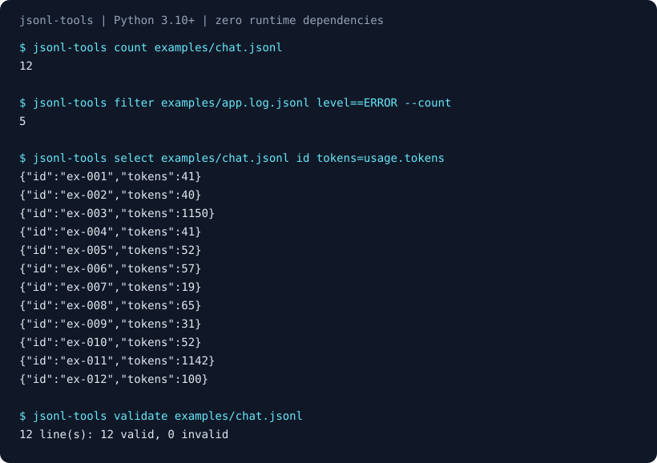

# jsonl-tools
[](https://github.com/YusufBeratZengin/jsonl-tools/actions/workflows/ci.yml) [](https://pypi.org/project/jsonl-tools/) [](LICENSE) [](pyproject.toml) [](pyproject.toml)

[English](README.md) | [Türkçe](README.tr.md)

Stream, inspect and transform large JSONL and gzip files from the command line or Python.
Zero runtime dependencies; all processing stays on your machine.
Install from this checkout: `python -m pip install .`
Try: `jsonl-tools filter examples/chat.jsonl "usage.tokens>1000" --count`



## Demo

Run these commands from the repository root after installing:

```console
jsonl-tools count examples/chat.jsonl
jsonl-tools filter examples/app.log.jsonl "level==ERROR" --count
jsonl-tools select examples/chat.jsonl id tokens=usage.tokens
jsonl-tools validate examples/chat.jsonl
```

The first command prints `12`, the second prints `5`, and validation prints
`12 line(s): 12 valid, 0 invalid`. The complete captured output is in
[docs/demo.txt](docs/demo.txt). Regenerate it and the SVG with
`python scripts/make-demo.py`; the script calls the actual CLI with synthetic examples.

## Install

Requires Python 3.10 or newer. From this source checkout:

```console
python -m pip install .
```

This repository is version 0.1.0; a registry release is not assumed. Installation
needs the Hatchling build backend; running from source needs only Python.
After installation, `python -m jsonl_tools` and `jsonl-tools` expose the same commands.

## Usage

### CLI

```console
jsonl-tools head examples/chat.jsonl -n 2
jsonl-tools tail examples/chat.jsonl -n 2
jsonl-tools stats examples/chat.jsonl --field usage.tokens
jsonl-tools schema examples/chat.jsonl
jsonl-tools sample examples/chat.jsonl -n 3 --seed 7
jsonl-tools dedupe examples/chat.jsonl --by model
jsonl-tools split examples/chat.jsonl --lines 5 --out-dir is/parts
```

Use `-` as FILE to read stdin. Filter and select require FILE explicitly; the
other commands default to stdin. Quote expressions so shells do not interpret
`>`, `<`, or wildcards. `--help` is available on every command.

### Python API

```python
from jsonl_tools import SchemaInferrer, Stats, compile_expr, read_jsonl

matches = compile_expr("usage.tokens>1000")
stats, schema = Stats(), SchemaInferrer()
for record in read_jsonl("examples/chat.jsonl"):
    if matches(record):
        stats.add(record)
        schema.add(record)
print(stats.result()["records"])  # 2
print(schema.schema()["type"])  # object
```

`read_jsonl(path, skip_bad=False)` is lazy and accepts strings and `Path` objects.
Invalid records raise `BadLineError` with the physical line number. Low-level
`open_input`, `open_output`, `iter_lines`, `iter_records`, path helpers and
operations in `jsonl_tools.ops` are also available. `Stats.result()` and
`SchemaInferrer.schema()` return JSON-serializable dictionaries.

## Examples

[examples/chat.jsonl](examples/chat.jsonl) contains synthetic model conversations;
[examples/app.log.jsonl](examples/app.log.jsonl) contains synthetic service logs.
Neither example calls a model or another service.

```console
jsonl-tools filter examples/chat.jsonl "model==demo-large" --and "usage.tokens>1000" --count
jsonl-tools select examples/chat.jsonl id "roles=messages[].role" --null-missing
jsonl-tools validate examples/chat.jsonl --object --json
```

Paths support `a.b`, `a[0]`, negative indexes and `a[].b`. `[]` matches any list
element in filters and collects matches in select. Missing fields differ from
`null`. Select preserves nested object keys; aliases, indexes, wildcards and
`--flat` produce flat keys. Keys containing dots/brackets have no escape syntax.

## Configuration / options

No configuration file or environment variables are needed.

| Command | Main options | Behavior |
| --- | --- | --- |
| `head`, `tail` | `-n N`, `-o FILE` | First/last N nonblank lines; default 10 |
| `count` | FILE | Number of nonblank lines; does not validate JSON |
| `filter` | EXPR, `--and`, `--or`, `--invert`, `--count` | `(EXPR or alternatives) and all additional conditions` |
| `select` | FIELD…, `alias=path`, `--flat`, `--null-missing` | Project or rename fields |
| `stats` | `--json`, `--field`, `--top`, `--max-paths`, `--max-depth` | Presence, types, numeric summary and frequent values |
| `schema` | `--no-required`, `--max-props` | Infer draft 2020-12 JSON Schema |
| `split` | `--lines N` or `--size SIZE`, `--out-dir`, `--prefix`, `--gzip` | Numbered files; never cut a record |
| `sample` | `-n N` or `--fraction P`, `--seed` | Reproducible sample in input order |
| `dedupe` | `--by PATH`, `--canonical`, `--verbose`, `-o FILE` | Keep the first occurrence |
| `validate` | `--object`, `--json`, `--quiet`, `--limit`, `--clean FILE` | Report bad lines, optionally save good ones |

Filter operators: `== != > >= < <= ~ !~`, `PATH exists`, `PATH missing`.
Right-hand values are JSON literals or bare strings; regexes use Python `re`.
Equality distinguishes booleans from numbers. `!=` and `!~` negate any-match,
so missing fields satisfy them. No Python code is evaluated.

`--skip-bad` applies to filter, select, stats, schema and field-based dedupe;
the skipped count and first five line numbers go to stderr. Raw/canonical
dedupe retains invalid lines and compares them as bytes when parsing fails.
Input gzip is detected by content; `-o FILE.gz` and `--clean FILE.gz` compress.
Split sizes use powers of 1024 (`64k`, `2MiB`); sizes count uncompressed output
bytes including LF. An oversized line gets its own part. Existing split parts
are overwritten; use a fresh output directory. Input/output aliases are rejected.

Exit codes: **0** success, **1** validation found invalid lines, **2** input,
argument or processing error; interrupted commands exit **130**.

## How it works

Input is UTF-8, optionally starting with a BOM. Blank lines are ignored and
output uses LF. Raw operations strip surrounding line whitespace and otherwise
preserve JSON formatting; select serializes compact JSON. Each nonblank line
must contain exactly one JSON value for parsed operations. `NaN` and `Infinity`
and floating-point literals that overflow to infinity are rejected. Plain-file
tail reads backwards; gzip and stdin tail retain N lines.

Stats tracks at most 500 paths to depth 12 (root depth 0), with a 4,096-value
numeric reservoir and 1,000 frequent-value candidates per path. Percentiles and
frequencies flag approximate results. Schema caps keys per object at 200 and
depth at 32; observed required properties are inferred, not guaranteed.

## Limitations / privacy note

Everything runs locally without telemetry or network requests. Output may
contain your input data; choose output locations accordingly. Streaming memory
depends on the largest line, tail/sample size and tracked paths. Dedupe stores
one 128-bit digest per unique key plus Python set overhead and has a theoretical
hash-collision risk. Split retains output filenames. Wildcards can expand large arrays.
Regex execution has no timeout: use trusted patterns.

Schema inference does not validate against an existing schema. Numeric summaries
use floating point; integers outside finite float range are counted by type but
excluded from numeric summaries. Path syntax does not address every JSON key.
Failed transformations can leave partial output; writes are not atomic.

## Development

Run inside a source checkout, with development dependencies available:

```console
python -m pip install -e ".[dev]"
python -m ruff check .
python -m mypy src
python -m pytest --cov=jsonl_tools --cov-report=term-missing --cov-fail-under=85
python scripts/make-demo.py --check
python -m build
python -m twine check dist/*
```

CI tests Python 3.10–3.13 on Linux and Windows and enforces at least 85% branch-inclusive
coverage. Tests use synthetic data and no network. See [CONTRIBUTING.md](CONTRIBUTING.md)
for offline execution and release requirements.

## Contributing

Read [CONTRIBUTING.md](CONTRIBUTING.md), [CODE_OF_CONDUCT.md](CODE_OF_CONDUCT.md)
and [SECURITY.md](SECURITY.md). Changes follow [CHANGELOG.md](CHANGELOG.md).

## License

[MIT](LICENSE) © 2026 Yusuf Berat Zengin.
